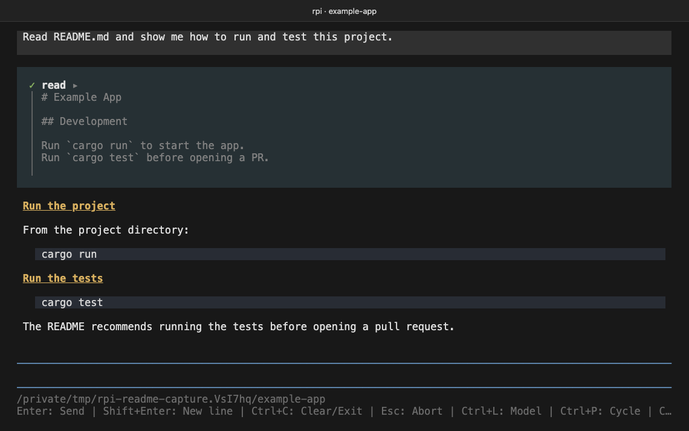
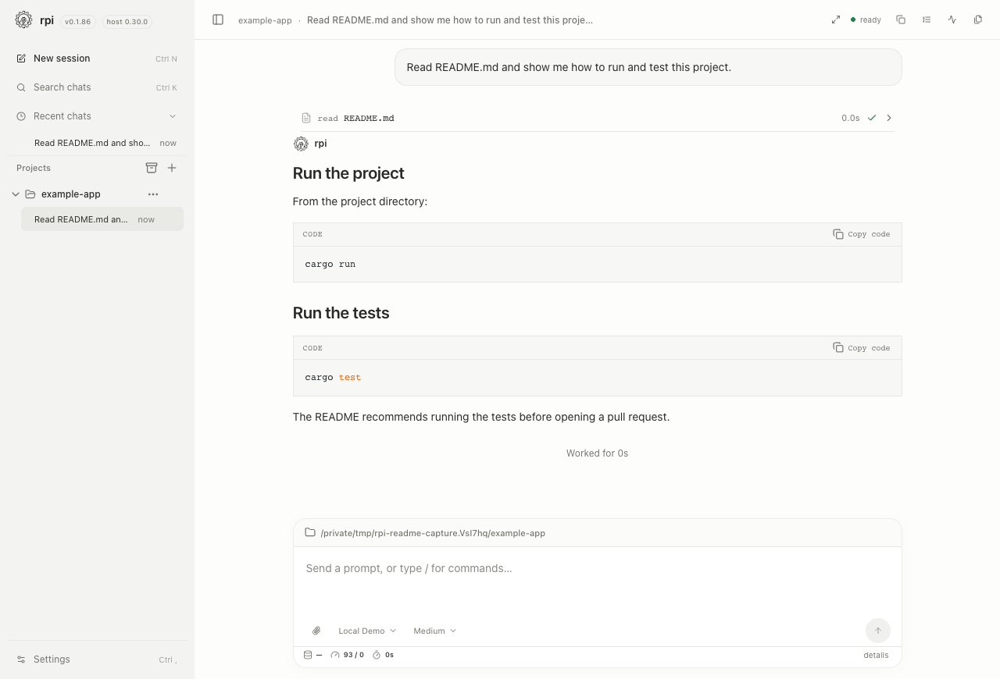
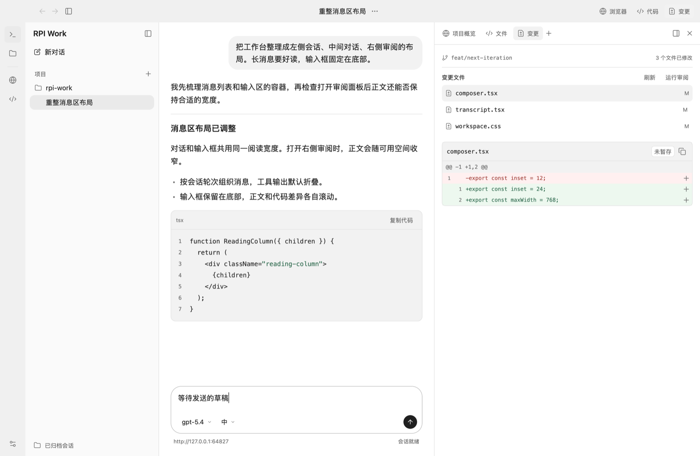
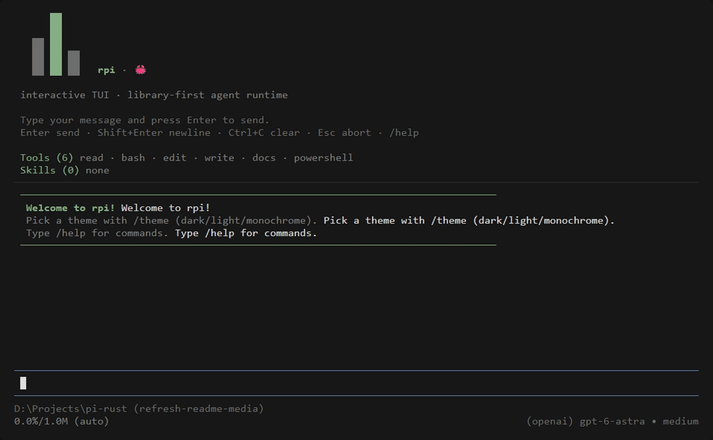

# rpi · Rust 原生编码智能体运行时

[English](README.md) | **简体中文**

<p align="center">
  
</p>

[](https://crates.io/crates/rpi-cli)
[](https://crates.io/crates/rpi-cli)
[](https://docs.rs/rpi-cli)
[](#许可证)
[](#安装)
[](https://github.com/bigfish1913/pi-rust/actions/workflows/ci.yml)
[](https://github.com/bigfish1913/pi-rust/stargazers)
[](https://github.com/bigfish1913/pi-rust/releases/latest)
[](https://github.com/RyanAlberts/best-of-Agent-Harnesses)

`rpi` 是用 Rust 编写、以库为核心的编码智能体运行时，并在其上提供了一个终端智能体。
工作区包含 11 个可组合的 crate，涵盖模型提供方适配、可从崩溃恢复的智能体循环、可复用的运行时、终端界面和稳定的插件 ABI。
你可以将同一套实现作为 SDK 嵌入应用，也可以直接运行 `rpi` 命令。

rpi 最初是 Mario Zechner 的 [Pi TypeScript SDK](https://github.com/earendil-works/pi) 的 Rust 实现，现已具备自己的 Rust 原生插件 ABI 和执行基础设施。
上游项目的归属说明见[致谢](#致谢)和 [NOTICE](NOTICE)。

[快速上手](#快速上手) · [官网](https://rpi.bigfisharc.cn/) · [文档](https://rpi.bigfisharc.cn/docs.html) · [扩展目录与收录](https://rpi.bigfisharc.cn/packages.html?lang=zh) · [rpi-extension](https://github.com/pi-rust/rpi-extension)

## 演示



**终端。** 在项目目录运行 `rpi`。图中展示隔离示例会话和一次 `read` 工具调用。[用户指南](docs/guides/user-guide.md)



**Web。** 运行 `rpi install rpi-web` 安装扩展，然后在项目目录运行 `rpi --webserver`，打开终端输出的地址。[Web 安装指南](https://github.com/pi-rust/rpi-extension/tree/main/packages/rpi-web)



**桌面端。** RPI Work 的 GPUI 预览版在原生窗口中展示项目会话、对话和 Git 差异。[RPI Work](https://github.com/pi-rust/rpi-work)

<details>
<summary>终端和 SDK 录屏</summary>



<sub>启动终端智能体后即可用 `/help` 查看帮助，无需真实 API 密钥或模型请求。录制脚本见 [`demo/tui.tape`](demo/tui.tape)。</sub>


<sub>无需 API 密钥或网络，按测试所用的路径运行智能体循环和一次真实的 `write` 工具调用。录制脚本见 [`demo/sdk.tape`](demo/sdk.tape)，可用 `task demo` 重新生成。</sub>

</details>

## 三种用法

| 目标 | 所需依赖 | 从这里开始 |
| --- | --- | --- |
| 直接使用终端编码智能体 | 无需添加依赖 | `cargo install rpi-cli` |
| 在自己的进程里运行智能体 | `rpi-agent`（可加 `rpi-ai`、`rpi-tools`） | [`examples/minimal`](examples/minimal) |
| 为会话添加工具或模型提供方 | `rpi-plugin-sdk` | [`examples/plugin-stub`](examples/plugin-stub) |

三种用法共用一套实现。你可以在内嵌的智能体里调试工具，再把同一套代码打包成由全局 `rpi` 加载的 `cdylib` 插件。推荐的项目布局见[智能体项目结构](docs/agent/project-structure.md)。

## 安装

**预编译二进制**（无需 Rust 工具链）

```bash
curl -fsSL https://raw.githubusercontent.com/bigfish1913/pi-rust/main/scripts/install.sh | sh
```

脚本会验证发布的 SHA-256 校验值，再安装到 `/usr/local/bin` 或 `~/.local/bin`。可通过 `--dry-run` 预览安装操作。

在 **Windows (x64)** 上使用 PowerShell 5.1 或更高版本运行以下命令。

```powershell
& ([scriptblock]::Create((Invoke-WebRequest -UseBasicParsing https://raw.githubusercontent.com/bigfish1913/pi-rust/main/scripts/install.ps1).Content))
```

脚本会验证发布的 SHA-256 校验值，再安装到 `$env:LOCALAPPDATA\Programs\rpi`。
按脚本输出的说明添加 PATH，然后运行 `rpi --version`。可附加 `-DryRun` 预览，或使用 `-Version <version>` 和 `-Dir 'C:\Tools\rpi'` 指定版本和目录。

**通过 npm 安装**（需要 Node.js 20 或更新版本，无需 Rust 工具链）

```bash
npm install -g @bigfishnpm/rpi
rpi --version
```

npm 安装器从 GitHub Releases 下载对应平台的二进制，并按包内固定的 SHA-256 校验值验证归档和可执行文件。
支持 macOS（x64/ARM64）、Windows（x64）和 Linux（x64 glibc/musl、ARM64 glibc）。

**通过 crates.io 安装**（需要 Rust 1.88 或更新版本）

```bash
cargo install rpi-cli
rpi --version
```

**通过包管理器安装**

```bash
brew tap bigfish1913/tap && brew install rpi          # macOS（Apple 芯片）、Linux
scoop bucket add bigfish1913 https://github.com/bigfish1913/scoop-bucket
scoop install rpi                                     # Windows
```

在 macOS 上，Homebrew 配方目前支持 Apple 芯片。Intel Mac 可以使用提供 `x86_64-apple-darwin` 产物的版本的预编译安装脚本，也可以运行 `cargo install rpi-cli`。[winget 安装清单正在审核](https://github.com/microsoft/winget-pkgs/pull/444745)。

**从源码运行**

```bash
git clone https://github.com/bigfish1913/pi-rust.git
cd pi-rust && cargo run -p minimal   # 离线智能体，无需 API 密钥
```

以下是两个离线示例的实际输出。两者都无需凭据或网络，每次运行的输出一致。用 `task demo-transcript` 可重新生成。

```text
$ cargo run -q -p minimal
minimal example: 2 messages after run
  - user
  - assistant
assistant reply: Hello from the faux provider!
AgentEnd observed.

$ cargo run -q -p tools-example
tools example: 4 messages after run
wrote out.txt (28 bytes): "hello from the tools example"
AgentEnd observed; tool ran against OsExecutionEnv.
```

## 快速上手

### CLI

```bash
export ANTHROPIC_API_KEY=...          # 使用 OpenAI 时设置 OPENAI_API_KEY
rpi                                   # 交互式终端界面
rpi -p "总结这份 README"               # 单次运行
rpi --mode json -p "列出所有 crate"    # 机器可读的事件流
rpi --mini -p "解释这个错误"           # 单次运行，结束后不保存会话
```

`--mini` 使用内存会话并关闭原生持久化执行。进程退出时会话结束，该模式不支持会话导入、导出、分叉或恢复。上下文压缩、工具和资源发现仍可使用。用 `--tools read` 可将工具限制为 `read`，用 `-p` 可在单次回复后退出。

普通会话保存为 JSONL。运行中崩溃后，`rpi` 从最后一条已提交的帧恢复。

### 模型配置

使用自定义 OpenAI 兼容网关时，将[示例 JSON](examples/models.example.json)另存为 `models.json`，放在下表所示的目录中。目录不存在时先创建。已有 `models.json` 时，把 `gateway` 条目加入现有的 `providers` 对象。

| 环境 | `models.json` 路径 |
| --- | --- |
| macOS / Linux | `~/.rpi/agent/models.json` |
| Windows | `%USERPROFILE%\.rpi\agent\models.json` |
| 自定义目录 | `RPI_CODING_AGENT_DIR` 指定的绝对目录下的 `models.json` |

```json
{
  "providers": {
    "gateway": {
      "api": "openai-completions",
      "baseUrl": "https://api.example.com/v1",
      "apiKey": "$RPI_GATEWAY_API_KEY",
      "models": [
        { "id": "your-model-id", "name": "My Gateway Model" }
      ]
    }
  }
}
```

将 `baseUrl` 和 `your-model-id` 替换为提供方给出的地址和模型 ID，再在启动 rpi 的终端中设置密钥。

- macOS / Linux — `export RPI_GATEWAY_API_KEY='your-api-key'`
- Windows PowerShell — `$env:RPI_GATEWAY_API_KEY = 'your-api-key'`

```bash
rpi auth check --provider gateway
rpi --model gateway/your-model-id
```

启动命令中的模型 ID 要与 JSON 一致。[用户指南](docs/guides/user-guide.md#自定义-provider)也涵盖 Anthropic 兼容网关的配置。

### 运行时诊断

要排查模型请求准备、上下文构建、工具执行或助手帧持久化的耗时，可临时把诊断输出到 stderr。

```bash
RPI_AGENT_DIAGNOSTICS=1 RPI_FRAME_DIAGNOSTICS=1 \
  rpi -p "复现这个问题" 2>rpi-diagnostics.log
```

`RPI_AGENT_DIAGNOSTICS` 报告上下文、请求、工具和追加会话记录的耗时。`RPI_FRAME_DIAGNOSTICS` 报告持久化帧的批处理、刷新屏障及写入失败。
变量未设置或为 `0` 时诊断关闭。诊断输出与会话 JSONL 分开。
字段含义见 [Rust 调试指南](docs/debugging/rust-debugging.md)，也可以向内置只读 `docs` 工具传入 `{"topic":"debugging","query":"RPI_FRAME_DIAGNOSTICS"}` 查询。

### 请求超时与模型兼容性

`--timeout 600` 限制整个 LLM 请求的耗时，包括流式响应。
响应开始后，`--stream-idle-timeout 300` 单独限制响应体连续未收到数据的时间。每个非空数据块都会重置空闲计时器，包括 SSE 心跳和不完整的帧。
流停滞会产生可重试的错误，是否重试取决于所配置的重试策略。持续接收数据的流可以运行超过空闲超时，直至达到总超时。
`--stream-idle-timeout 0` 可关闭空闲计时器。也可在 `~/.rpi/agent/settings.json` 中设置 `"streamIdleTimeout": 300`（单位为秒），命令行参数优先。
`httpIdleTimeout` 用于回收连接池内未使用的连接。

对于使用 `"api": "openai-completions"` 的提供方，在 `~/.rpi/agent/models.json` 中为每个模型设置 `compat` 对象，例如：

```json
"compat": {
  "thinkingFormat": "deepseek",
  "requiresReasoningContent": true
}
```

`requiresReasoningContent` 通过 `reasoning_content` 回传助手的推理内容，没有推理内容时使用空字符串。
也接受 Pi 的配置名 `requiresReasoningContentOnAssistantMessages`。两个字段同时存在时，以 rpi 的字段为准，值冲突时会发出警告。
`thinkingFormat` 支持 `"openai"`（默认请求格式）和 `"deepseek"`（对具备推理能力的模型额外发送 `thinking: { "type": "enabled" | "disabled" }`）。
如果网关无法接收 `reasoning_effort`，可以用 `supportsReasoningEffort: false` 省略该字段。`requiresThinkingAsText` 会把推理内容放入普通文本。
未知字段和无效值会触发带有提供方及模型名的警告，无效的 `compat` 对象会被忽略。

### SDK

使用进程内的确定性提供方构建智能体。示例无需 API 密钥或网络。

```rust
use rpi_agent::AgentBuilder;
use rpi_ai::providers::faux::{FauxProvider, FauxScript};
use rpi_ai::Provider;

#[tokio::main]
async fn main() {
    // `FauxProvider::new` 已经返回 `Arc<Self>`。
    let provider = FauxProvider::new(FauxScript::new().with_text("Hello from the faux provider!"));
    let model = provider.default_model().clone();

    let agent = AgentBuilder::new()
        .model(model)
        .system_prompt("You are a helpful assistant.")
        .stream_fn(make_stream_fn(provider))
        .build()
        .expect("agent builds");

    let mut events = agent.subscribe();
    agent.prompt("hi").await.expect("prompt completes");

    while let Ok(ev) = events.try_recv() {
        let _ = ev; // AgentEvent::{MessageUpdate, ToolEnd, AgentEnd, …}
    }
    println!("{} messages after the run", agent.state().messages.len());
}
```

`make_stream_fn` 将同步 `StreamFn` 接口与异步提供方衔接。完整代码见 [`examples/minimal/src/main.rs`](examples/minimal/src/main.rs)，可通过 `cargo run -p minimal` 运行。

## Crate 列表

工作区的 11 个 crate 共用同一个版本号。依赖关系保持单向，并在代码审查中检查。

```text
rpi-telemetry → rpi-ai → rpi-agent → rpi-tools → rpi-harness
                    ↘ rpi-runtime
```

另外六个 crate 在主依赖链之外。

- `rpi-durable` 为 `rpi-harness` 提供独立于后端的检查点校验与进度投影。这是一个不依赖其他 `rpi-*` crate 的原生库，同名工作流扩展由独立包提供。
- `rpi-tui` 无其他 `rpi-*` 依赖。
- `rpi-runtime` 依赖 `rpi-ai`，提供可嵌入的模型目录、凭据解析和执行绑定。详见[运行时指南](docs/architecture/reusable-runtime.md)。
- `rpi-plugin-sdk` 提供宿主的插件接口，无其他 `rpi-*` 依赖。`rpi-tools` 复用其中的环境变量名称，确保宿主和插件通过 ABI 交换的名称一致。
- `rpi-extensions` 使用 `rpi-plugin-sdk`、`rpi-ai` 和 `rpi-agent` 托管可运行工具的插件。
- `rpi-cli` 整合终端界面、会话框架和插件加载器，并通过 `rpi-harness` 引入 `rpi-durable`。

| Crate | 职责 |
| --- | --- |
| [`rpi-telemetry`](https://crates.io/crates/rpi-telemetry) | 定义追踪 span 和事件接口，默认空操作，可按需启用观测，无需 tracing 或 OpenTelemetry 后端 |
| [`rpi-ai`](https://crates.io/crates/rpi-ai) | 定义与模型提供方无关的消息、流式响应和工具 schema 类型，提供 Anthropic、OpenAI 兼容和 `faux` 提供方 |
| [`rpi-runtime`](https://crates.io/crates/rpi-runtime) | 可嵌入的模型目录、凭据解析、模型选择和执行绑定 |
| [`rpi-agent`](https://crates.io/crates/rpi-agent) | 智能体循环、`AgentTool` 接口、事件、钩子、队列和取消 |
| [`rpi-tools`](https://crates.io/crates/rpi-tools) | `read`、`write`、`edit`、`bash` 等工具，以及 `grep`、`find`、`ls`、`powershell` 和 `ExecutionEnv` 接口 |
| [`rpi-durable`](crates/rpi-durable) | 独立于后端的检查点校验和助手进度投影，工具执行与存储由调用方负责 |
| [`rpi-harness`](https://crates.io/crates/rpi-harness) | 会话树、JSONL 持久化、上下文压缩、崩溃恢复及运行循环 |
| [`rpi-tui`](https://crates.io/crates/rpi-tui) | 终端界面的组件、布局、编辑器和对话渲染 |
| [`rpi-cli`](https://crates.io/crates/rpi-cli) | `rpi` 二进制，涵盖终端界面、单次运行、JSON 模式、配置和插件加载 |
| [`rpi-plugin-sdk`](https://crates.io/crates/rpi-plugin-sdk) | 稳定的 `#[repr(C)]` 插件 ABI，无 `rpi-*` 依赖，`serde_json` 由默认启用的 `json` feature 控制 |
| [`rpi-extensions`](https://crates.io/crates/rpi-extensions) | 宿主侧插件加载器，以及跨 ABI 的异步工具桥接 |

各 crate 都有自己的 README 和 docs.rs 页面。`crates/rpi-*` 目录与发布的 crate 名称共用 `rpi-` 前缀。

## 为什么用 rpi

`rpi` 提供可嵌入的运行时和开箱即用的终端入口。

- **可嵌入。** `rpi-agent` 加上 `rpi-ai` 即可在应用进程里运行智能体，自行处理事件和输出。
- **可离线测试。** 内置确定性的 `faux` 提供方和内存执行环境。`rpi-ai` 通过 `providers` feature 控制真实 HTTP 提供方，便于对测试路径隔离网络依赖。
- **可恢复。** 会话采用树结构，以 JSONL 按帧保存进度。恢复时从已提交的进度继续。有外部副作用的工具需要自行实现幂等和恢复检查。
- **可通过稳定接口扩展。** 插件以 Rust `cdylib` 交付，通过手写的 C ABI 与宿主通信。接口支持版本协商并隔离 panic，可以兼容编译器与 crate 版本差异。
- **共用工具实现。** 全局 CLI 和内嵌智能体可以加载同一套工具。

### 与其他编码智能体比较

其他工具的资料截至 2026 年 9 月。此表持续维护 `rpi` 一列，其他工具的最新信息请查阅各自的文档。

| | rpi | Claude Code | Codex CLI | opencode | aider |
| --- | --- | --- | --- | --- | --- |
| 语言 | Rust | TypeScript | Rust | TypeScript/Go | Python |
| 源码公开 | ✅ MIT | ❌ | ✅ | ✅ | ✅ |
| 可作为库嵌入 | ✅ | ❌ | ❌ | ⚠️ | ⚠️ |
| 内置插件 ABI | ✅ | hooks/MCP | ❌ | 插件 API | ❌ |
| 无头服务端与远程客户端 | ✅ | ⚠️ | ✅ | ✅ | ⚠️ |
| 支持不同提供方的网关 | ✅ | ❌ | ❌ | ✅ | ✅ |

[Best of Agent Harnesses](https://github.com/RyanAlberts/best-of-Agent-Harnesses) 将 rpi 收录在 *Coding agent products* 类别，评为 **bounded** 和 **durable**。后者源于可在崩溃后恢复的 JSONL 会话。

## 性能

数据测自 Windows 11（x86_64），使用 rustc 1.97.1 和 `--release`。两个脚本均可在本机重新构建并测量。

`sh scripts/bench.sh` 测量 rpi 本身。

| 指标 | 数值 |
| --- | --- |
| Release 二进制体积 | **21.8 MiB** |
| `rpi --version` 实际耗时 | 中位数 **约 17 ms** |
| 智能体就绪后的 RSS | **12.0 MiB** |

`node scripts/bench-vs-pi.mjs --pi <path-to-pi>` 在同一台机器上与原版 Pi 对比。两者都离线运行，各自使用全新的隔离配置目录。

| 指标 | rpi（Rust） | pi（TypeScript） | 差异 |
| --- | ---: | ---: | --- |
| `--version` | **17.5 ms** | 169.5 ms | **耗时约为 1/9.7** |
| 冷启动 | **17.7 ms** | 189.5 ms | **耗时约为 1/10.7** |
| 就绪 RSS | **12.0 MiB** | 91.5 MiB | **约为 1/7.6** |
| 安装体积 | **21.8 MiB**（单个二进制） | 约 385 MiB（另加约 91 MiB 的 Node） | **约为 1/18 到 1/22** |

**冷启动**从创建进程计时到智能体响应第一条命令，包含完整初始化，排除退出过程与 LLM 调用。rpi 的 `--version`（17.5 ms）和冷启动（17.7 ms）耗时接近，主要耗时在进程创建上。Pi 的主要耗时在启动 Node 上。

rpi 使用 `RPI_CODING_AGENT_DIR` 和 `RPI_OFFLINE`，原版 Pi 使用 `PI_CODING_AGENT_DIR` 和 `PI_OFFLINE`。用各自对应的变量隔离配置，以免加载本机全局插件。
[性能对比报告](docs/performance/benchmark-vs-pi.md)包含测量方法、每次运行的原始数据和测量范围。

## 插件

插件是通过稳定 `#[repr(C)]` ABI 加载的 Rust `cdylib` 库，可以注册工具、模型提供方、斜杠命令、事件处理器、Markdown 渲染器和可发现资源。

```bash
rpi install rpi-todo                    # 预编译扩展，无需 Rust 工具链
rpi install my-ext --path ../my-ext     # 从本地路径安装，用于开发
rpi extension update [name]             # 更新所有符合条件的扩展，或按名称更新
rpi dev                                 # 构建、监听变更并实时重载
```

`rpi extension update` 更新所有项目级链接扩展和通过注册表或预编译产物全局安装的扩展，也可以用 `rpi extension update <name>` 指定名称。
更新时会保留原来的 Cargo 构建后端或指定的 GitHub 来源。使用 `--path` 安装的全局开发扩展不参与更新。
旧命令 `rpi package update [name]` 仍兼容。项目级链接使用 `rpi package link`、`rpi package list` 和 `rpi package unlink`。

宿主依次从项目的 `.rpi/extensions`、全局的 `~/.rpi/agent/extensions` 和 `--extensions-dir` 指定的目录加载扩展。

开发 Rust 插件时，可以参考[扩展开发指南](docs/extensions/authoring.md)和 `examples/plugin-stub`，通过 `rpi-plugin-sdk` 实现 `cdylib` 入口。
如果正在开发 Web 或 ACP 适配器，需要复用会话、工作区、原生 RPC 或持久化运行时逻辑，可额外使用 [`rpi-extcore`](https://crates.io/crates/rpi-extcore)（`rpi-extcore = "0.1"`）。

可直接安装的扩展由配套的 [`pi-rust/rpi-extension`](https://github.com/pi-rust/rpi-extension) 仓库维护，可在[在线目录](https://rpi.bigfisharc.cn/packages.html?lang=zh)查询。

目录已从 `pi-rust/rpi-package` 迁移到 `pi-rust/rpi-extension`。两个名称指向同一个发布方。
已有的安装记录（包括只存有 `prebuilt:<repository>` 标记的记录）、`--github pi-rust/rpi-package` 和旧 CDN 前缀仍可使用。版本查询和启动时的更新检查会跟随迁移并更新记录中的来源。

目录提供安装命令，[`packages/` 源码目录](https://github.com/pi-rust/rpi-extension/tree/main/packages)提供各扩展的 README 和示例。可先运行 `rpi install rpi-todo`，再参照[扩展开发指南](docs/extensions/authoring.md)编写自己的扩展。

### 网络访问

使用下列扩展为 CLI 添加网页搜索和公开网页读取工具。

```bash
rpi install rpi-websearch                # websearch：标题、URL 和摘要
rpi install rpi-webfetch                 # webfetch：提取公开网页的可读文本
```

安装后重启 rpi 以加载工具。点击、登录和执行网页 JavaScript 需要独立的浏览器工具。

### 继承配置的子智能体

安装配套的 `rpi-subagents` 扩展来使用 `delegate_task`。

```bash
rpi install rpi-subagents
```

宿主记录父会话当前生效的模型与提供方绑定、思考强度、系统提示词、资源、请求选项、可用工具、项目工作目录和审批钩子。
子智能体直接使用这份配置，在独立的内存会话中运行，父会话的历史记录保留在父会话中。模型凭据由宿主持有。

宿主 API 只允许缩小继承的工具范围。子智能体无法调用 `delegate_task`，宿主也会拒绝递归委派。
审批使用父会话的界面，父会话完成或取消时会停止子智能体。隔离范围是会话和工具权限，进程仍运行在宿主的操作系统权限下。

请使用支持 `IndependentRun` 的子智能体扩展。Rust 调用方使用 `AgentHarness::create_independent_run`。扩展通过 `GetExecutionContext` 读取当前绑定，通过 `IndependentRun` 管理运行。生命周期与限制详见[子智能体协议](docs/extensions/subagents.md)。

### 开发扩展

```rust
use rpi_plugin_sdk::{export_plugin, StbStringRef};

export_plugin!(|api| {
    if let Some(declare) = api.declare {
        declare(StbStringRef::from_str(r#"{"priority":60,"platforms":["linux"]}"#));
    }
    // 通过 `api` 注册工具和处理器
    0
});
```

[`examples/plugin-stub`](examples/plugin-stub) 是一个完整插件，演示了 `execute`、`poll`、`cancel` 和 `destroy` 的生命周期。ABI 安全要求见[扩展开发指南](docs/extensions/authoring.md)。

## Unix 本地共享 Host

`rpi --host [area]` 在每个区域的同一个本地 Host 进程中运行独立的智能体会话，支持普通交互式 TUI、stdio RPC，以及通过 `rpi --host [area] --mini "prompt"` 单次运行。`default` 区域使用普通会话存储。其他区域默认使用 agent 目录下的 `local-host-v1/area-<name>/sessions`，也可以显式指定会话目录。命名区域可设置 `maxAgents`（默认 32，范围 1–256）和 `idleTimeoutSeconds`（默认 0，关闭）。

## macOS 持久化共享 Host 区域

```bash
rpi --native-host                 # 在终端打开默认区域的会话
rpi --native-host work            # 打开独立区域及其会话
rpi --native-host --mode json     # 查看所选区域以及 Host 和会话 ID
```

首次进入时会创建 `$RPI_CODING_AGENT_DIR/host.json`（通常为 `~/.rpi/agent/host.json`）并启动后台 Host。默认会启动一个持久化智能体。选择同一智能体的客户端共享它的会话。请从智能体配置的工作区启动其客户端。

配置文件初始内容为 `{"defaultArea":"default","areas":{"default":{}}}`。每个区域可设置 `provider`、`model`、`tools` 和 `maxAgents`，也可在 `recovery` 中设置 `restore_on_start` 和 `restart_on_crash`，例如 `{"restore_on_start":true,"restart_on_crash":false}`。命名区域省略整个 `recovery` 时会启用两项。显式提供 `recovery` 对象时，省略的开关默认为 `false`。容量与恢复设置会在首次生成区域私有配置时写入。初始智能体配置使用全局模型设置和可用的非 OAuth 凭据，默认工具为 `read`。私有智能体配置与 Host 配置保存在 `hosts/<area>/`，重启时复用。`--mode json` 会输出配置路径，可用于 `status`、`administrative-stop` 等 [Host 管理命令](crates/rpi-cli/src/host/cli.rs)。

首次进入前可设置 `runTimeoutMs`，为持久化操作指定自受理起计算的执行时限，单位为毫秒。到期后 daemon 会发出取消信号，等待操作与会话写入完成。该值保存到生成的私有配置 `host.default_timeouts.run_ms`，可通过 `host.hard_timeout_limits.run_ms` 指定上限。首次进入前还可设置 `shutdownGraceMs`，以便在信号或管理停机期间，报告在给定毫秒数后仍在关闭的智能体。daemon 会继续等待关闭完成。该值对应私有配置的 `host.default_timeouts.shutdown_grace_ms`，可通过 `host.hard_timeout_limits.shutdown_grace_ms` 指定上限。启用 Mini 控制的 daemon 要求共享智能体的默认计时器留空。

首次进入前设置区域的 `idleTimeoutMs` 或 `disconnectedTimeoutMs`，分别写入私有配置的 `host.default_timeouts.idle_ms` 和 `host.default_timeouts.disconnected_ms`。空闲计时器到期后，可在工作结束时释放会话写入权限和容量槽位。已认证的区域会话连接会让智能体保持加载。对于拥有区域会话路由的智能体，断连计时器从最后一个已认证连接离开时开始，新连接会清除该计时器。两个计时器都设置时，智能体已结束工作且没有会话连接后，以先到期的计时器为准。执行中或有待处理会话工作时，智能体保留所有权。可使用对应的 `host.hard_timeout_limits` 字段设置上限。

计时器与 `restoreOnAttach` 需要 `restore` 权限。任一设置启用时，生成的管理策略会向所有声明的成员授予 `restore` 和 `cancel`。使用 `host inspect` 和 `host profiles` 获取当前 `Unloaded` 修订号与冻结配置的引用，再运行 `host administrative-restore` 恢复原智能体及其会话。随后区域终端和 stdio RPC 客户端可以重连同一 daemon 中的会话。首次进入前设置 `restoreOnAttach: true`，可让已认证的会话连接直接从冻结配置恢复 `Unloaded` 成员。该选项默认关闭，沿用显式恢复的容量和会话写入检查，显式请求仍单独写入管理回执日志。对行政关闭为 `Closed` 的成员，需显式恢复。管理关闭命令接受 `Unloaded` 修订号，会关闭已加载所有者的会话连接，并将该成员移出恢复配置。

允许 daemon 在没有已加载智能体时继续运行的场景，可在私有配置设置 `host.host_idle_timeout_ms`。当驻留智能体和控制或会话连接持续为空达到指定毫秒数后，daemon 会关闭。进行中的生命周期事务可能推迟关闭。

若要在同一区域配置更多持久化智能体，请在首次进入前在区域配置中添加 `"agentProfiles":[{"name":"review","path":"/absolute/private/review.json"}]`。各份[私有智能体配置](crates/rpi-cli/src/host/profile.rs)指定自己的智能体 ID、会话 ID、会话路径和工作区。默认智能体计入 `maxAgents`。请从默认智能体的工作区初始化区域，再从成员自己的工作区运行 `rpi --native-host work --agent review`，按需加 `--mode json` 或 `--mode rpc`。区域私有配置会保存这些配置引用，并同时启动声明的智能体和默认成员。

在顶层 `host.json` 中设置 `"restoreAreas":["default","work"]`，并在 `areas` 下声明每个列出的区域。可从任意工作区运行 `rpi --native-host --restore-areas` 批量启动对应 daemon。每个区域都须具备启用了 `restore_on_start` 的现有私有 daemon 配置。命令会先校验全部区域配置，再启动所需 daemon，复用正在运行的区域，并以 JSON 输出各区域的结果。通过 `administrative-stop` 停止的区域只要仍在列表中，就会在下一次批量恢复时启动。

在顶层 `host.json` 中设置 `"defaultTerminal":true`，就可从默认区域智能体的工作区直接运行 `rpi` 进入该智能体。首次使用需运行 `rpi --native-host` 初始化区域。带参数的调用、重定向输入或输出的调用，以及从其他工作区启动的调用仍使用普通 CLI 入口。Host 终端提供共享对话、历史记录和取消。可通过普通 CLI 入口使用本地会话选择器和扩展界面。

终端支持共享文本提示词、实时回复、保存的历史记录和取消。智能体空闲时，可用 `/thinking <level>` 更改后续提示词的思考级别。连接到该智能体的终端都会显示新级别。stdio RPC 客户端可使用 `set_thinking_level` 并接收 `thinking_level_changed`。设置在智能体保持加载期间有效，恢复时使用冻结配置。关闭终端会断开该终端的连接。

## 远程模式

```bash
rpi --server                        # 启动无头 TCP 智能体服务并输出认证令牌
rpi --connect host:port --token T   # 通过终端界面连接远程服务
```

模型提供方、工具、扩展和会话文件由服务端管理。客户端通过终端界面操作远端智能体。详见[远程模式用户指南](docs/remote/user-guide.md)。

## 项目状态

| 项目 | 状态 |
| --- | --- |
| 当前版本 | **[0.32.0](https://github.com/bigfish1913/pi-rust/releases)**（11 个工作区 crate 共用版本号） |
| 稳定接口 | 计划保持 `rpi-ai`、`rpi-agent`、`rpi-tools`、`rpi-harness` 和 `rpi-plugin-sdk` 的接口稳定 |
| 最低 Rust 版本（MSRV） | 1.88 |
| 支持的平台 | Linux（GNU 和 musl）、macOS、Windows（CI 在 Linux 上运行测试套件） |
| 二进制发布目标 | Linux（x86_64 GNU/musl、aarch64 GNU）、macOS（Intel/Apple 芯片）、Windows（x86_64） |

`rpi` 是自包含的 Rust 编码智能体，运行时无需 Node。

## 文档

[文档索引](docs/README.md)按功能整理了各篇指南。

- [用户指南](docs/guides/user-guide.md) — 命令、配置、会话和技能
- [架构概览](docs/architecture/overview.md) — 各 crate 的职责和依赖关系
- [搭建智能体项目](docs/agent/project-structure.md) — 推荐的项目结构
- [扩展开发](docs/extensions/authoring.md) — 插件模板和 ABI 规则
- [子智能体](docs/extensions/subagents.md) — 配置继承、权限和生命周期
- [原生 RPC 资源选择](docs/resource-selection-rpc.md) — 精确指定启动时使用的包、技能、扩展、指令和工具（阶段 A）
- [原生本地资源管理](docs/local-resource-management.md) — 按作用域安装、查看、更新和移除快照，以及所有权、恢复和宿主租约（阶段 B）
- [远程模式](docs/remote/user-guide.md) — 协议、令牌和限制
- [路线图](ROADMAP.md) · [更新日志](CHANGELOG.md)
- [docs.rs](https://docs.rs/rpi-cli) — 各 crate 的 API 文档

## 参与贡献

欢迎提交 issue 和 PR。[贡献指南](CONTRIBUTING.md)包含构建与测试命令和仓库结构，[路线图](ROADMAP.md)列出了已有计划。安全问题请按 [SECURITY.md](SECURITY.md) 中的流程报告。

要收录你在自己的 GitHub 仓库发布的 Rust 扩展，请打开[扩展目录](https://rpi.bigfisharc.cn/packages.html?lang=zh)，点击 **我要收录**。

完整测试套件支持离线运行，命令为 `cargo test --workspace --locked`。

## 致谢

感谢 Mario Zechner 和 [Pi 贡献者](https://github.com/earendil-works/pi)提供原版 TypeScript SDK，以及启发 rpi 的智能体、工具和会话设计。
rpi 用 Rust 重新实现了这些设计，并采用自己的运行时和扩展体系。上游版权和 MIT 许可证声明保留在 [LICENSE](LICENSE) 和 [NOTICE](NOTICE) 中。

## 许可证

MIT，详见 [LICENSE](LICENSE) 和 [NOTICE](NOTICE)。

## 赞赏支持

如果 rpi 帮到了你，欢迎请作者喝杯咖啡，支持持续开发与维护。感谢每一份支持！

<table>
  <tr>
    <th>微信支付</th>
    <th>支付宝</th>
    <th>Binance Pay</th>
  </tr>
  <tr>
    <td align="center"><a href="https://assets.bigfisharc.cn/images/support/wechat.png"></a></td>
    <td align="center"><a href="https://assets.bigfisharc.cn/images/support/alipay.jpg"></a></td>
    <td align="center"><a href="https://assets.bigfisharc.cn/images/support/binance.png"></a></td>
  </tr>
</table>

可扫码或点击查看原图。手机上可以保存图片后，在对应 App 中识别。

## 交流群

欢迎交流使用问题、分享想法和体验新功能。

<table>
  <tr>
    <td align="center" width="50%">
      <a href="https://assets.bigfisharc.cn/images/support/weixin.png?date=2026-11-27"></a><br>
      <sub><b>微信交流群</b> — 扫码加入</sub>
    </td>
    <td align="center" width="50%">
      <a href="https://t.me/+7YfN4TZPP7Y0M2Q1"></a><br>
      <sub><b>Telegram</b> — <a href="https://t.me/+7YfN4TZPP7Y0M2Q1">t.me/+7YfN4TZPP7Y0M2Q1</a></sub>
    </td>
  </tr>
</table>

<sub><a href=".github/workflows/readme-images.yml">README 图片刷新工作流</a>每天（UTC+8）更新微信群图片链接中的日期参数，以刷新图片缓存。如果入群邀请失效，请提交 issue。</sub>

## Star 趋势

[](https://www.star-history.com/#bigfish1913/pi-rust&pi-rust/rpi-extension&Date)

## 贡献者

感谢所有参与代码、文档、问题反馈和建议的贡献者！

[](https://github.com/bigfish1913/pi-rust/graphs/contributors)

[完整贡献者名单](https://github.com/bigfish1913/pi-rust/graphs/contributors) · [如何参与贡献](CONTRIBUTING.md)
